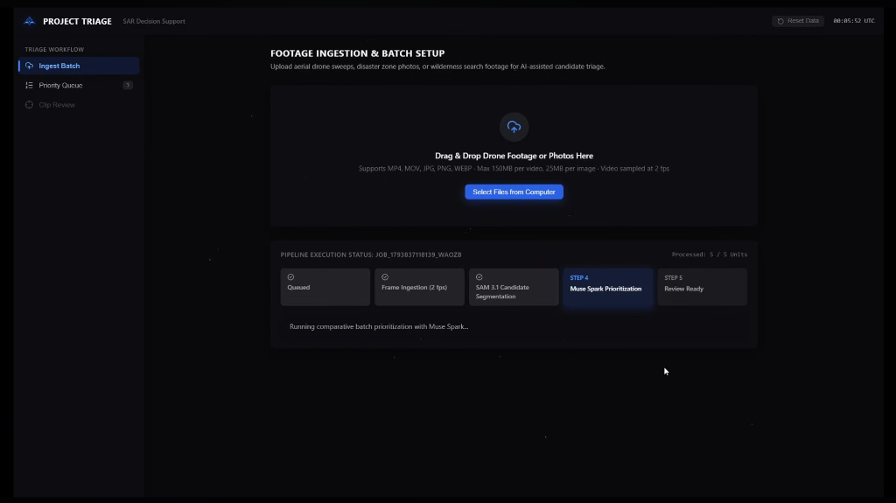
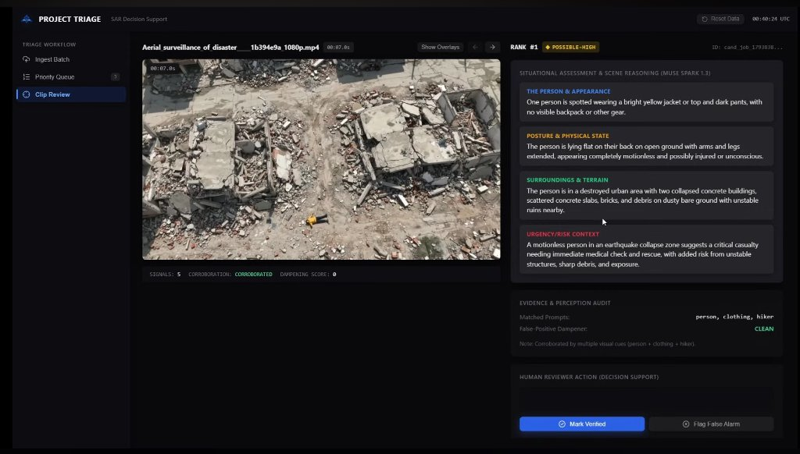
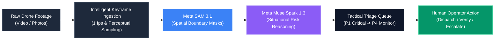
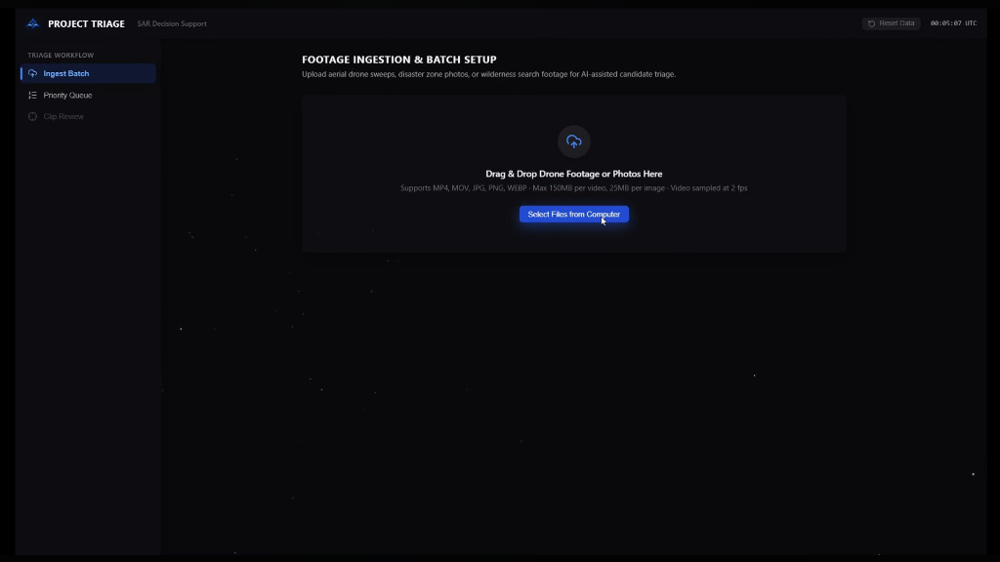
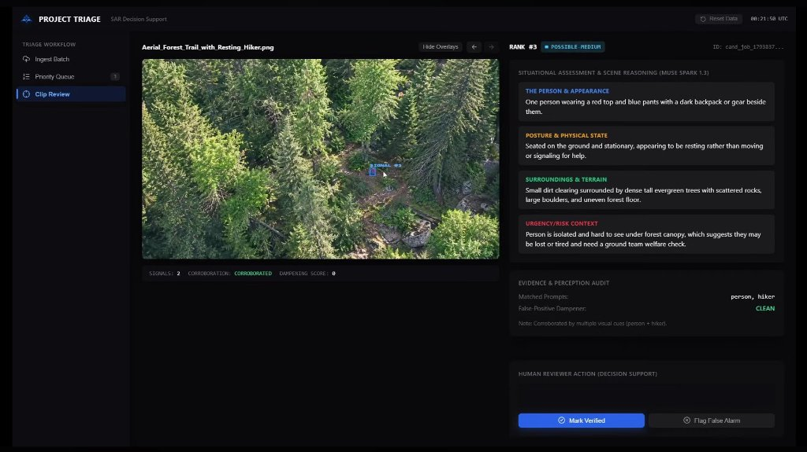

# Project Triage

[](LICENSE)
[](https://api.meta.ai)
[](https://www.youtube.com/watch?v=xDeto4KjvcE)
[](https://nodejs.org)
[](https://www.typescriptlang.org)

> **Tactical Aerial Search & Rescue (SAR) Reconnaissance Copilot**  
> Built for the **Meta Global AI Developer Hackathon** — Track: *Build for Your World*.

**Project Triage** is an AI-powered tactical reconnaissance copilot that transforms raw aerial drone sweeps into prioritized, life-saving intelligence. By pairing **Meta SAM 3.1** spatial segmentation with **Meta Muse Spark 1.3** situational reasoning, Triage eliminates hours of manual footage review during the golden hour of disaster response.

📺 **[Watch the 2-Minute Demo Video on YouTube](https://www.youtube.com/watch?v=xDeto4KjvcE)**

---

<p align="center">
  
  
</p>

---

## The Problem Statement

When floods, earthquakes, or wildfires hit, emergency teams deploy aerial drones capturing tens of thousands of high-resolution 4K frames. Spotting a motionless survivor, submerged clothing, or a distant distress gesture is an excruciating manual process. 

Responders face acute **cognitive fatigue** scanning miles of empty wreckage under extreme time pressure. In emergency triage, the first **"golden hour"** determines survival—yet valuable minutes are lost scrubbing through empty video streams.

## The Solution: Project Triage

Project Triage automates the reconnaissance bottleneck through an intelligent, zero-loss triage pipeline:
- **Intelligent Backlog Ingestion:** Ingests raw drone sweeps (MP4, MOV) and disaster photos, filtering thousands of redundant frames through motion and perceptual sampling.
- **Zero-Dismissal Safety Protocol:** AI never silently discards a candidate. High-confidence cues are prioritized, while ambiguous signals are elevated to human operators for verification.
- **Human-in-the-Loop Mission Control:** Responders inspect spatial segmentations, surrounding environmental hazards, and telemetry in an obsidian glassmorphism interface to dispatch rescue teams in seconds.

---

## Target Users

1. **Search & Rescue (SAR) Teams:** Rapidly pinpoint stranded hikers, missing persons, or injured victims in dense wilderness or rugged terrain.
2. **Emergency Operations Centers (EOC):** Triage floodwaters and collapsed structures to deploy medical and extraction units by urgency.
3. **UAV / Drone Recon Operators:** Process raw drone sweeps immediately upon landing (or over field uplinks) without needing manual scrubbing.

---

## System Workflow



---

## Meta AI Integration & Significance

Project Triage bridges the critical gap between basic object detection and actionable rescue reasoning by combining two Meta model families:

| Meta Model | Role in Pipeline | Tactical Significance |
| :--- | :--- | :--- |
| **Meta SAM 3.1**<br/>(`sam-3.1`) | **Spatial Perception & Zero-Shot Segmentation** | Generates pixel-accurate boundary masks for survivors, clothing, and vehicles across chaotic wilderness, rubble, and flood terrain without task-specific fine-tuning. |
| **Meta Muse Spark 1.3**<br/>(`muse-spark-1.3`) | **Contextual Reasoning & Hazard Triage** | Evaluates the immediate environment around each candidate (immobility, structural instability, rising water) to compute structured risk scores and assign priority tiers (P1 to P4). |

**Why this matters:** Traditional computer vision stops at drawing a generic bounding box. Meta Muse Spark understands *why* a detected person in a collapsed building is in critical danger (P1) versus an upright resting hiker on a trail (P3), giving commanders instant situational context.

---

<p align="center">
  
  
</p>

---

## Setup & Startup Instructions

### Prerequisites
- **Node.js** (v18.0.0 or higher)
- **npm** (v9.0.0 or higher)
- **Meta Model API Key**

### 1. Installation
Clone the repository and install all dependencies:
```bash
git clone https://github.com/Manthan-cpp/TRIAGE.git
cd TRIAGE
npm run install:all
```

### 2. Configure Environment
Copy the example environment file and add your Meta API key:
```bash
cp .env.example .env
```
Inside `.env`:
```ini
META_MODEL_API_KEY=your_meta_model_api_key_here
META_MODEL_API_BASE_URL=https://api.meta.ai/v1
PORT=4000
```

### 3. Build & Launch
Build both frontend and backend bundles, then start the production server:
```bash
npm run build
npm start
```
Open **`http://localhost:4000`** in your browser.

> **Instant State Reset:** To clear test jobs, evaluation candidates, and uploaded cache back to a clean slate, click the **Reset Data** button in the dashboard or run:
> ```bash
> npm run reset
> ```

---

## Acknowledgements

- **Meta AI & Cerebral Valley:** For hosting the Meta Global AI Developer Hackathon and providing access to the Meta Model API ecosystem (SAM 3.1 & Muse Spark 1.3).
- **Academic Benchmark Datasets:** Evaluation imagery uses open, simulated academic search-and-rescue datasets with actors:
  - **SARD (Search and Rescue Image Dataset for Person Detection):** Sambolek & Ivasic-Kos (2021), *IEEE Access*.
  - **UAV-SAR (Low-Altitude UAV Person Detection Benchmark):** CC-BY 4.0.
  - **NOMAD:** Russell Bernal et al. (WACV 2024).
  - **HERIDAL:** Božić-Štulić et al. (2019), *IEEE Transactions on Cybernetics*.
  *(No actual disaster casualties or trauma footage are included).*

---

## License & Contributing

- **License:** Distributed under the [MIT License](LICENSE).
- **Contributing:** Please review our [Contributing Guidelines](CONTRIBUTING.md) to learn about our code standards, test suite, and life-safety design principles.
